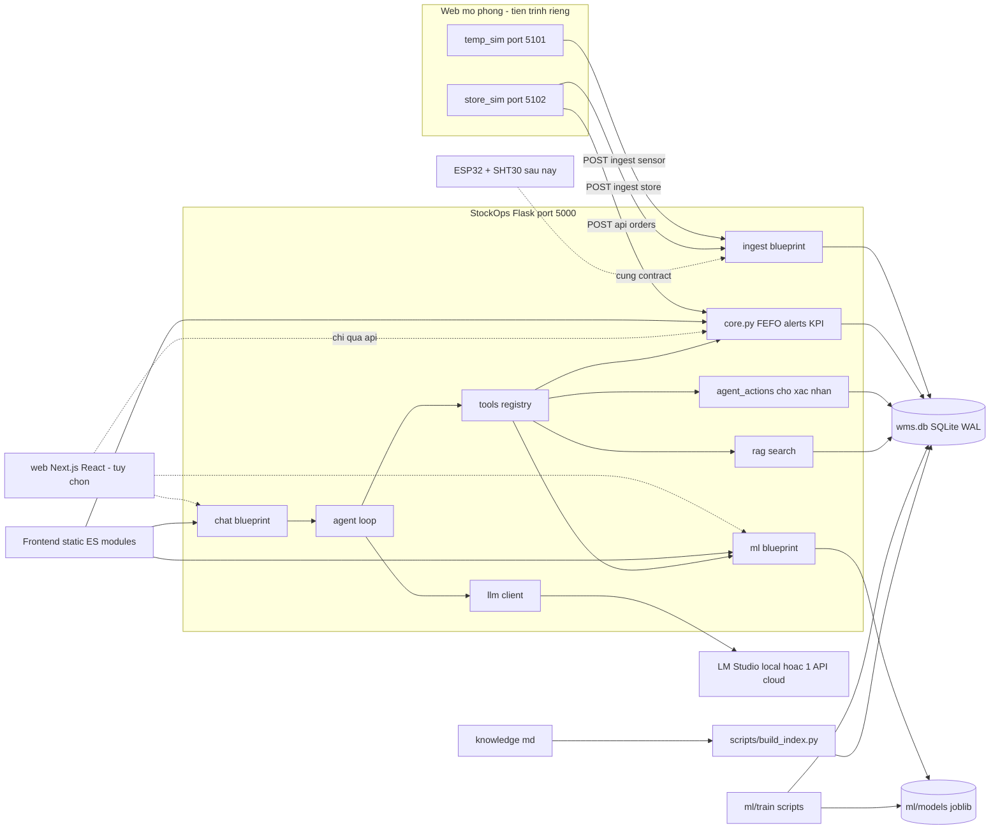

# StockOps (ECONEXUS_WAREHOUSE) — Architecture

> Generated on 2026-11-20 | Momento: **validate** — prototype chạy local, 1 dev, đang chuẩn bị mở rộng sang AI Agent + mô phỏng + ML

## Summary

StockOps hiện là một **monolith Flask + SQLite + HTML/JS thuần (ES modules)**, tổ chức theo feature (mỗi chức năng 1 blueprint Python + 1 file JS), nghiệp vụ lõi (FEFO, chặn tồn âm, cảnh báo, KPI) gom gọn trong `wms/core.py`. Nền này **sạch và đúng tầm** — không có thứ gì thừa. Việc cần làm không phải là đập đi xây lại, mà là thêm 4 lớp theo đúng thứ tự: **(1) cổng nhận dữ liệu thời gian thực → (2) các web mô phỏng tạo dữ liệu → (3) model tự train học từ dữ liệu đó → (4) agent Kvis dùng tool + RAG để hỏi đáp và đề xuất hành động**.

Điểm then chốt: hiện DB chỉ có ~30 giao dịch trong 7 ngày — **không đủ để train bất kỳ model nào**. Vì vậy web mô phỏng không chỉ để "trình diễn", nó chính là **nhà máy sinh dữ liệu huấn luyện**. Thứ tự các phase bên dưới đi theo chuỗi phụ thuộc đó.

## Dimensions (đã suy ra từ code + bối cảnh)

| Dimension | Giá trị | Độ tin cậy | Căn cứ |
|---|---|---|---|
| project_moment | validate | 0.95 | prototype, chạy `python app.py`, chưa có auth |
| product_type | web (internal tool) + data/ML | 0.95 | Flask + static SPA |
| team_size | 1 | 0.9 | dự án cá nhân/môn học |
| user_scale | < 1k (thực tế < 10) | 0.9 | chạy local, demo |
| monthly_budget | free | 0.8 | sinh viên, đã thử LM Studio local |
| needs_realtime | mềm (trễ 2–5s chấp nhận được) | 0.8 | dashboard nhiệt độ, lượt khách |
| access_pattern | balanced + **time_series** | 0.85 | sensor readings, traffic theo giờ |
| has_offline | false (nhưng chạy LAN được) | 0.8 | host=0.0.0.0 |
| latency_critical | false | 0.9 | dashboard nội bộ |
| compliance | none | 0.9 | dữ liệu mô phỏng |
| ai_complexity | **agentic + rag + training** | 0.95 | yêu cầu: agent, RAG chatbot, model tự train |

## Alignment Score

```
📊 Architecture Alignment — validate moment

  Stack hiện tại vs lý tưởng cho validate:

  ✅ Flask monolith + blueprints     — đúng tầm, dễ thêm feature
  ✅ SQLite (wms.db)                 — đủ cho 1 dev, < 10 user, vài triệu dòng
  ✅ HTML/CSS/JS ES modules          — không build step, dễ hiểu
  ✅ Nghiệp vụ gom ở core.py         — agent tool sẽ gọi lại đúng chỗ này
  ✅ Transaction qua run() + CHECK   — tồn âm bị chặn ở cả DB lẫn code
  ✅ Chat chưa gọi API từ frontend   — đúng: key không lộ ra trình duyệt
  ⚠️  SQLite journal_mode=delete     — sẽ "database is locked" khi simulator ghi liên tục
  ⚠️  Không có migration             — bảng `icons` tồn tại trong wms.db nhưng không có trong code
  ⚠️  debug=True + host=0.0.0.0      — debugger Werkzeug mở trên Wi-Fi chung
  ⚠️  requirements không pin version, không có .env, không có test
  ❌ Chưa có bảng time-series         — zones.temp là 1 con số tĩnh, không có lịch sử
  ❌ Chưa có dữ liệu lịch sử đủ train — 30 txs / 7 ngày

  Alignment: ~75% — KHÔNG có complexity thừa; thiếu nền móng cho phase AI
```

## Architecture Diagram (ASCII)

```
 ┌──────────── WEB MÔ PHỎNG (tiến trình riêng) ─────────────┐     ┌──────────────────┐
 │  temp_sim  :5101   (nhiệt độ/độ ẩm 4 khu kho)            │     │ ESP32 + SHT30     │
 │  store_sim :5102   (lượt khách vào/ra, bán lẻ, đặt hàng) │     │ (thay sim sau này)│
 └───────┬───────────────────────────┬──────────────────────┘     └────────┬─────────┘
         │ POST /api/ingest/*        │ POST /api/orders (bổ sung hàng)     │ cùng contract
         ▼                           ▼                                     ▼
 ┌──────────────────────────── StockOps Flask :5000 ─────────────────────────────────┐
 │  features/ingest.py ──► sensor_readings, store_traffic, store_sales               │
 │  features/*.py (cũ) ──► core.py (FEFO, alerts, KPI)                               │
 │  features/ml.py     ──► ml/models/*.joblib  (dự báo nhu cầu, lượt khách, rủi ro t°)│
 │  features/chat.py   ──► wms/ai/agent.py                                           │
 │                           ├─ tools.py  → gọi core.py / ml / rag (chỉ ĐỌC)         │
 │                           ├─ propose_* → agent_actions (chờ người xác nhận)        │
 │                           ├─ rag.py    → doc_chunks (embedding trong SQLite)      │
 │                           └─ llm.py    → LM Studio local / 1 API cloud (.env)     │
 └───────────────────────────────┬────────────────────────────────────────────────────┘
                                 │        ▲ /api/*
                                 │        ├── static/  (HTML + JS thuần, đang dùng)
                                 │        └── web/     (Next.js + React, tùy chọn)
                                 ▼
                       wms.db (SQLite, WAL mode)
                                 ▲
     ml/train_*.py (chạy tay, offline) ──┘──► ml/models/     knowledge/*.md ─► scripts/build_index.py
```

## Architecture Diagram (Mermaid)



## Cấu trúc thư mục mục tiêu

```
StockOps/
├── app.py
├── .env.example                 # LLM_BASE_URL, LLM_MODEL, LLM_API_KEY, INGEST_KEY, FLASK_DEBUG
├── requirements.txt             # pin version
├── wms/
│   ├── __init__.py  db.py  core.py  seed.py
│   ├── migrate.py               # chạy migrations theo PRAGMA user_version
│   ├── migrations/              # 001_base.sql, 002_users.sql, 003_timeseries.sql, 004_ai.sql ...
│   ├── features/                # (cũ) + ingest.py, ml.py, chat.py
│   └── ai/
│       ├── llm.py               # 1 client, cấu hình bằng .env
│       ├── tools.py             # schema + hàm của từng tool
│       ├── agent.py             # vòng lặp: LLM → tool → LLM (tối đa 5 bước)
│       ├── rag.py               # chunk, embed, search
│       └── prompts.py           # system prompt (prompt là code, có version)
├── static/                      # giao diện hiện tại (JS thuần)
├── web/                         # (tùy chọn, chưa tạo) Next.js + React, chỉ gọi /api/*
│   ├── app/<feature>/page.tsx
│   ├── lib/api.ts               # 1 hàm gọi API dùng chung
│   └── next.config.ts           # dev: proxy /api -> :5000; build: xuất file tĩnh
├── ml/
│   ├── features.py              # DÙNG CHUNG cho train và predict
│   ├── train_demand.py  train_traffic.py  temp_risk.py  evaluate.py
│   └── models/                  # *.joblib + registry.json (gitignore file .joblib)
├── sims/
│   ├── common/clock.py          # đồng hồ mô phỏng: live (x1..x3600) và backfill
│   ├── common/client.py         # gửi dữ liệu lên /api/ingest/*
│   ├── temp_sim/  (app.py + static/)
│   └── store_sim/ (app.py + static/)
├── knowledge/                   # tài liệu cho RAG (SOP, quy định, hướng dẫn)
├── scripts/  backfill.py  build_index.py  run_all.py
├── tests/
└── docs/architecture.md
```

## Dùng Ngay

### Flask + SQLite + HTML/JS thuần (giữ nguyên)
- **Role:** backend nghiệp vụ, API, phục vụ giao diện; nguồn sự thật duy nhất (single source of truth) cho tồn kho.
- **Why now:** team_size=1, user < 10, budget free — đang chạy tốt, bạn đã hiểu nó. Viết lại sang FastAPI/React/Postgres = vài tuần không thêm chức năng nào.
- **When to replace:** xem "Thêm Sau" (PostgreSQL, SSE).

### SQLite ở chế độ WAL + busy_timeout
- **Role:** cho phép simulator ghi liên tục trong khi web vẫn đọc. *WAL (Write-Ahead Logging): ghi vào file nhật ký trước, người đọc không bị chặn bởi người ghi.*
- **Why now:** access_pattern có time_series + 2 tiến trình simulator ghi đồng thời → chế độ `delete` hiện tại sẽ gây lỗi `database is locked`.
- **When to replace:** khi `sensor_readings` > 5 triệu dòng hoặc lỗi lock vẫn > 1 lần/ngày sau khi bật WAL.

### Migration tự viết (PRAGMA user_version + file .sql)
- **Role:** thay đổi cấu trúc DB có đánh số, không phải xóa `wms.db` mỗi lần thêm bảng.
- **Why now:** sắp thêm ~8 bảng; DB đã lệch khỏi code (bảng `icons` mồ côi). Alembic quá nặng cho SQLite + raw SQL.
- **When to replace:** khi chuyển sang PostgreSQL + SQLAlchemy → dùng Alembic.

### Ingest API (`/api/ingest/sensor`, `/api/ingest/store`)
- **Role:** cửa ngõ duy nhất để dữ liệu "thế giới bên ngoài" (simulator, sau này ESP32/POS thật) vào hệ thống. Có header `X-Ingest-Key` lấy từ `.env`.
- **Why now:** đúng yêu cầu "chuyển đổi giữa dữ liệu mô phỏng và dữ liệu thực" — đổi nguồn mà không sửa StockOps. ESP32 + SHT30 bạn đã từng làm có thể POST thẳng vào đây.
- **When to replace:** thêm MQTT khi có ≥ 3 thiết bị thật (xem "Thêm Sau").

### Web mô phỏng = các Flask app nhỏ, mỗi app 1 cổng
- **temp_sim (:5101):** nhiệt độ 4 khu theo mô hình làm lạnh Newton (nhiệt độ tiến dần về setpoint), dao động theo ngày/đêm, sự kiện "mở cửa kho" (tăng vọt rồi hồi), nút "hỏng máy nén" (trôi dần lên). Thanh trượt: nhiệt độ môi trường, tốc độ x1/x60/x3600.
- **store_sim (:5102):** các cửa hàng (chính là khách hàng đang có trong `sos`: Siêu thị An Phú, Tạp hóa Minh Tâm…). Lượt khách/giờ = nền × hệ số giờ × hệ số thứ × lễ/Tết × mưa × nhiễu Poisson. Khách mua → giảm tồn kệ cửa hàng → dưới ngưỡng thì tạo đơn bổ sung (SO) gửi lên StockOps qua `/api/orders` có sẵn.
- **Hai chế độ đồng hồ:** `live` (chạy theo thời gian thực × tốc độ, có tạo SO thật) và `backfill` (sinh ngay 180 ngày lịch sử, **chỉ ghi traffic/sales/readings, không bao giờ đụng tới batches/sos**).
- **Why now:** đây là nguồn dữ liệu train duy nhất bạn có. Tách tiến trình (thay vì trang trong StockOps) để ranh giới "hệ thống bên ngoài ↔ WMS" là thật — giống hệt khi thay bằng thiết bị thật.
- **When to replace:** khi có dữ liệu thật ≥ 90 ngày cho 1 nguồn → tắt sim tương ứng.

### scikit-learn (HistGradientBoostingRegressor) + pandas + joblib
- **Role:** model tự train: (1) nhu cầu theo SKU/ngày, (2) lượt khách theo cửa hàng/giờ (`loss="poisson"` vì là số đếm), (3) rủi ro nhiệt độ.
- **Why now:** dữ liệu cỡ ~10 SKU × 180–365 ngày → cây quyết định + đặc trưng trễ (lag) thắng deep learning ở kích thước này; chạy CPU, không cần GPU. HGB của sklearn là cùng họ thuật toán với LightGBM, không phải cài thêm.
- **Bắt buộc:** so với baseline "cùng thứ tuần trước" (seasonal naive). Model không thắng baseline trên tập test theo thời gian (28 ngày cuối) → **không đưa vào dùng**.
- **When to replace:** LightGBM khi dữ liệu > 1 triệu dòng hoặc > 50 đặc trưng.

### Rủi ro nhiệt độ: luật + ngoại suy xu hướng (chưa cần ML)
- **Role:** "Kho mát đang tăng 0.2°C/phút, dự kiến vượt 8°C sau ~12 phút" = hồi quy tuyến tính trên 30 phút gần nhất + z-score trượt để phát hiện bất thường.
- **Why now:** đơn giản, giải thích được, hữu ích ngay. Isolation Forest để sau.

### Agent "Kvis": 1 LLM + tool calling, tự viết vòng lặp (~100 dòng)
- **Role:** "AI tổng quản". Các "AI con" (dự báo, cảnh báo, tồn kho, tài liệu) là **tool** — hàm Python xác định, không phải LLM riêng.
- **Tool chỉ đọc:** `get_stock`, `get_alerts`, `get_kpis`, `get_zone_status`, `forecast_demand`, `forecast_traffic`, `temp_risk`, `search_docs`.
- **Tool đề xuất:** `propose_po`, `propose_adjust` → ghi vào bảng `agent_actions` (trạng thái `proposed`); giao diện hiện thẻ "Xác nhận / Từ chối"; bấm xác nhận mới gọi API nghiệp vụ có sẵn.
- **Why now:** ai_complexity=agentic nhưng team=1 → 1 agent là đủ; đúng quy tắc dự án "AI không tự ý thay đổi tồn kho".
- **When to replace:** xem multi-agent ở "Thêm Sau".

### LLM client: `requests` → endpoint chuẩn OpenAI, cấu hình bằng `.env` (mặc định OpenRouter)
- **Role:** `wms/ai/llm.py` gửi POST tới `{LLM_BASE_URL}/chat/completions`. Mặc định là OpenRouter (`https://openrouter.ai/api/v1`, model `:free`); đổi sang LM Studio (`http://localhost:1234/v1`) chỉ cần sửa `.env`. Chỉ **1 provider đang bật** tại một thời điểm.
- **Why now:** budget=free, bạn đã có LM Studio. Lưu ý: model local < 7B gọi tool rất kém; nên dùng model instruct có hỗ trợ tool calling cỡ 7B+ (nếu GPU đủ VRAM) hoặc API cloud khi demo.

### RAG: sentence-transformers (local) + embedding lưu trong SQLite + numpy
- **Role:** trả lời câu hỏi về **tài liệu** (SOP bảo quản lạnh, quy trình FEFO/nhận hàng, định nghĩa KPI, hướng dẫn dùng web) kèm nguồn trích dẫn. Model embedding đa ngôn ngữ chạy CPU (vd `intfloat/multilingual-e5-small`).
- **Why now:** corpus < 1.000 đoạn → tìm cosine bằng numpy trên toàn bộ mất < 1ms; không cần vector DB.
- **Lưu ý quan trọng:** RAG **không huấn luyện** model — nó tìm đoạn tài liệu liên quan rồi đưa vào prompt. Câu hỏi về **số liệu sống** ("SKU-003 còn bao nhiêu?") phải đi qua tool đọc DB, **không** qua RAG.

### Realtime bằng polling 3–5 giây
- **Role:** dashboard và trang giám sát tự gọi lại API định kỳ.
- **Why now:** trễ vài giây chấp nhận được, < 10 người xem, không cần thêm hạ tầng.

### React + Next.js trong `web/` (được phép, dùng theo từng trang)
- **Role:** giao diện cho các trang phức tạp. Flask vẫn là backend duy nhất; `web/` chỉ gọi `/api/*`.
- **Why now:** chủ dự án quyết định mở (2026-11-25), xem ADR-011. product_type=web: một số trang sắp tới (giám sát nhiệt độ, dự báo, thẻ xác nhận của Kvis) có nhiều trạng thái hơn trang hiện tại.
- **Ràng buộc:** team_size=1 nên chỉ 1 bộ công cụ React (Next.js, đã gồm React); mỗi trang chỉ nằm ở 1 nơi; monthly_budget=free nên build ra file tĩnh cho Flask phục vụ, không thêm server.
- **When to replace:** nếu sau 2 trang mà thời gian làm mỗi trang không ngắn hơn bản JS thuần thì dừng, giữ `static/`.

## Thêm Sau

- **Server Node riêng cho Next.js (SSR)** — thêm khi có trang công khai cần SEO hoặc tải lần đầu > 3 giây trên 4G với bản tĩnh. Không phải bây giờ vì đây là công cụ nội bộ, < 10 người dùng. Effort: trung bình.
- **Chuyển hẳn mọi trang sang `web/`** — thêm khi ≥ 5 trên 9 màn hình đã nằm ở `web/`. Không phải bây giờ vì 9 màn hình JS thuần đang chạy tốt. Effort: trung bình.

- **Server-Sent Events (SSE)** — thêm khi cần cập nhật < 2 giây hoặc > 10 tab dashboard mở cùng lúc. Không phải bây giờ vì polling đủ và dễ debug. Effort: thấp.
- **PostgreSQL (+ pgvector)** — thêm khi `sensor_readings` > 5 triệu dòng, hoặc lỗi lock vẫn > 1 lần/ngày sau WAL, hoặc deploy cho > 5 người dùng đồng thời. Không phải bây giờ vì SQLite đang đủ và không cần cài server DB. Effort: trung bình (đã có migrations nên dễ hơn).
- **MQTT (Mosquitto)** — thêm khi có ≥ 3 thiết bị ESP32 thật hoặc cần gửi lệnh ngược xuống thiết bị. Không phải bây giờ vì HTTP POST đủ cho 2 simulator. Effort: trung bình.
- **APScheduler (train lại định kỳ / bản tin sáng)** — thêm khi bạn train lại bằng tay > 1 lần/tuần. Effort: thấp.
- **sqlite-vec** — thêm khi số đoạn tài liệu > 20.000 hoặc tìm kiếm > 200ms. Effort: thấp.
- **Reranker / tìm kiếm lai (từ khóa + vector)** — thêm khi bộ đánh giá RAG có tỉ lệ "đúng tài liệu nằm trong top-5" < 80% (thường do mã SKU, số lô). Effort: thấp.
- **Isolation Forest cho bất thường nhiệt độ** — thêm khi luật + z-score báo sai > 20% trên log sự cố đã gán nhãn. Effort: thấp.
- **Multi-agent (nhiều LLM chia vai)** — thêm khi agent có > 15 tool và bộ đánh giá cho thấy chọn sai tool > 20%. Effort: trung bình.
- **Đăng nhập + phân quyền** — **bắt buộc trước khi deploy ra Internet** (chat endpoint tiêu tiền API và đọc được toàn bộ kho). Effort: trung bình.
- **Docker** — thêm khi deploy lên VPS/server. Effort: thấp.

## Không Dùng Lúc Này

- **LangChain / LlamaIndex / CrewAI / AutoGen** — vòng lặp agent chỉ ~100 dòng; framework che đi đúng phần bạn cần học và debug. Reconsider when: > 3 agent cần chuyển giao nhau. Thay bằng: `wms/ai/agent.py` tự viết.
- **Vector DB riêng (Chroma, Qdrant, Pinecone)** — corpus < 1.000 đoạn. Reconsider when: > 100.000 đoạn. Thay bằng: bảng `doc_chunks` + numpy.
- **Fine-tune LLM** — không có dữ liệu hỏi-đáp gán nhãn; tool + RAG giải quyết được 95% nhu cầu. Reconsider when: có ≥ 1.000 cặp hỏi-đáp chuẩn và prompt đã hết cách cải thiện. Thay bằng: chỉnh system prompt + mô tả tool.
- **LSTM / Transformer / TFT cho dự báo** — vài trăm điểm dữ liệu/SKU, deep learning sẽ thua cây + lag và tốn GPU. Reconsider when: > 2 năm dữ liệu cho > 500 chuỗi. Thay bằng: HistGradientBoosting.
- **Kafka / Redis / Celery / RabbitMQ** — 2 nguồn dữ liệu, 1 nơi nhận. Reconsider when: > 100.000 sự kiện/ngày từ thiết bị thật. Thay bằng: HTTP POST + SQLite.
- **Text-to-SQL tự do (LLM tự viết SQL)** — model local hay viết sai số liệu, khó kiểm soát. Reconsider when: số tool cố định không đủ trả lời > 30% câu hỏi thực tế; khi đó dùng kết nối read-only. Thay bằng: tool có tham số rõ ràng.
- **Viết lại toàn bộ sang FastAPI + React + PostgreSQL (theo brief ban đầu)** — viết lại mất hàng tuần, không thêm chức năng. React/Next.js đã được phép dùng theo từng trang (ADR-011); phần backend vẫn giữ nguyên. Reconsider when: cần streaming bất đồng bộ cho nhiều người hoặc có > 1 dev frontend.
- **Vite, CRA, Vue, Svelte, Angular** — team 1 người không nên nuôi 2 bộ công cụ frontend cùng lúc với JS thuần. Reconsider when: bỏ Next.js. Thay bằng: Next.js trong `web/`.
- **Redux / thư viện quản lý state lớn** — trang hiện tại chỉ đọc API rồi vẽ. Reconsider when: > 3 trang trong `web/` phải chia sẻ cùng một state. Thay bằng: state của React.

## Architecture Decision Records

### ADR-001: Giữ Flask + SQLite + JS thuần
- **Choice:** mở rộng codebase hiện tại thay vì chuyển sang stack trong brief (FastAPI/React/Postgres).
- **Why:** team=1, đang chạy, nghiệp vụ lõi đã đúng; mọi tính năng AI đều làm được trên Flask.
- **Tradeoff:** không có async native, không có type schema tự động như Pydantic.
- **Revisit when:** điều kiện ở mục PostgreSQL / SSE trong "Thêm Sau".

### ADR-002: Simulator là tiến trình riêng, chỉ nói chuyện qua HTTP
- **Choice:** `sims/*` là Flask app độc lập, gửi dữ liệu qua `/api/ingest/*` và `/api/orders`; **không bao giờ ghi thẳng vào wms.db**.
- **Why:** giữ ranh giới hệ thống ngoài ↔ WMS; thay sim bằng ESP32/POS thật mà không sửa StockOps.
- **Tradeoff:** phải chạy 3 tiến trình → có `scripts/run_all.py`.
- **Revisit when:** không.

### ADR-003: 1 agent LLM + các "chuyên gia" là tool xác định
- **Choice:** chỉ 1 LLM; dự báo/cảnh báo/tồn kho/tài liệu là hàm Python.
- **Why:** rẻ, dễ debug, số liệu luôn đúng (lấy từ core.py), hợp với model local.
- **Tradeoff:** agent không "tự suy nghĩ" ngoài những tool có sẵn.
- **Revisit when:** > 15 tool và chọn sai tool > 20% trên bộ đánh giá.

### ADR-004: RAG chỉ cho tài liệu; số liệu sống đi qua tool
- **Choice:** `search_docs` cho văn bản; `get_*`/`forecast_*` cho dữ liệu.
- **Why:** nhúng số tồn kho vào vector sẽ cũ ngay sau giao dịch tiếp theo.
- **Tradeoff:** phải viết mô tả tool rõ để LLM chọn đúng đường.
- **Revisit when:** không.

### ADR-005: Agent chỉ được ĐỀ XUẤT ghi dữ liệu
- **Choice:** mọi hành động ghi đi qua bảng `agent_actions` → người bấm xác nhận → API nghiệp vụ có sẵn chạy (vẫn qua `core.run()` và transaction).
- **Why:** quy tắc dự án; LLM có thể hiểu sai số lượng/SKU.
- **Tradeoff:** thêm 1 bước bấm.
- **Revisit when:** không (với tồn kho).

### ADR-006: Train offline bằng script, phục vụ bằng joblib
- **Choice:** `ml/train_*.py` đọc DB → lưu `ml/models/*.joblib` + `registry.json` (metric, ngày train); Flask chỉ load và predict. Đặc trưng tính ở `ml/features.py` dùng chung cho train và predict.
- **Why:** tránh lệch train/serve; không cần MLflow cho ≤ 3 model.
- **Tradeoff:** train lại bằng tay.
- **Revisit when:** > 5 model hoặc train lại > 1 lần/tuần.

### ADR-007: Migration bằng PRAGMA user_version + file .sql
- **Choice:** `wms/migrate.py` chạy các file `wms/migrations/NNN_*.sql` có số > user_version, trong 1 transaction mỗi file.
- **Why:** nhẹ, hợp raw SQL; giữ được dữ liệu khi thêm bảng.
- **Tradeoff:** tự viết lệnh ALTER bằng tay.
- **Revisit when:** chuyển PostgreSQL → Alembic.

### ADR-008: Embedding chạy local, lưu trong SQLite
- **Choice:** sentence-transformers đa ngôn ngữ, vector float32 lưu BLOB trong `doc_chunks`.
- **Why:** miễn phí, không gửi tài liệu ra ngoài, đủ nhanh cho < 20k đoạn.
- **Tradeoff:** tải model ~0.5 GB lần đầu; lần đầu load chậm vài giây.
- **Revisit when:** điều kiện sqlite-vec / pgvector.

### ADR-010: Gọi LLM bằng `requests` thay vì thư viện `openai`
- **Choice:** dùng `requests` gọi thẳng REST `/chat/completions` qua OpenRouter.
- **Why:** ít phụ thuộc, thấy rõ từng request (dễ học và debug), JSON gọi tool ở Phase 5 vẫn y hệt; tránh phụ thuộc vào thay đổi API giữa các phiên bản lớn của SDK.
- **Tradeoff:** tự xử lý streaming/retry nếu cần.
- **Revisit when:** cần streaming từng chữ (SSE) cho chat.

### ADR-009: Dữ liệu mô phỏng phải có "quy luật ẩn" + nhiễu
- **Choice:** simulator sinh dữ liệu từ quy luật (giờ cao điểm, cuối tuần, Tết, mưa, khuyến mãi) + nhiễu ngẫu nhiên; tham số quy luật **không** được đưa trực tiếp làm đặc trưng.
- **Why:** để model thực sự phải học, và để đánh giá có ý nghĩa.
- **Tradeoff:** model chỉ chứng minh được **pipeline đúng**, không chứng minh độ chính xác ngoài đời thật — phải nói rõ điều này khi báo cáo.
- **Revisit when:** có dữ liệu thật.

### ADR-011: Cho phép React + Next.js ở frontend, trong `web/`
- **Choice:** nới ADR-001 ở phần frontend: được dùng React + Next.js trong `web/`, sống chung với `static/`. Phần backend của ADR-001 (Flask + SQLite) giữ nguyên.
- **Why:** quyết định của chủ dự án. Ranh giới là HTTP `/api/*`, nên nghiệp vụ tồn kho, transaction và quy tắc AI không bị ảnh hưởng.
- **Tradeoff:** thêm Node.js, npm và bước build; có 2 kiểu frontend cùng lúc; dev phải chạy 2 tiến trình (:3000 và :5000). Bản dùng thật vẫn chỉ cần Flask vì `web/` được xuất ra file tĩnh.
- **Revisit when:** ≥ 5 trên 9 màn hình nằm ở `web/` (chuyển nốt), hoặc sau 2 trang mà không nhanh hơn JS thuần (dừng).

### ADR-012: Kho 3D mặt bằng chữ U bằng Three.js trong `static/`
- **Choice:** mặt bằng chữ U với kệ thật theo khu. Migration `003_racks.sql` thêm `racks, bays, levels` vào `zones`, tổng 204 ô (DRY 4×6×4=96, COS 3×5×4=60, CHL 2×4×3=24, FRZ 2×4×3=24), thay `BINS = 12` cũ. `/api/layout` trả `bins` (số ô) và `items` (lô đang có hàng) theo khu, cùng `flow` lọc theo quyền (đơn nhập, đơn chờ lấy/đã lấy/đang xuất, đội xe, hàng cách ly). Kệ và hàng vẽ bằng `InstancedMesh`. Three.js 0.180.0 qua import map (CDN), gói trong `static/js/wh3d.js`, chỉ tải khi mở chế độ 3D; không tải được thì về sơ đồ 2D.
- **Why:** bố cục khớp mặt bằng kho thật; số ô lấy từ database nên không còn quy ước tạm; không cần bước build; sau này nạp được mô hình GLB bằng cách thay `makeRack()` và `makeLoad()`.
- **Tradeoff:** cần mạng ở lần tải đầu. 1 lô = 1 ô, ô không có sức chứa riêng nên màu mức đầy chỉ tính theo khu. Xe được gán vào cửa N1–N4/X1–X4 theo thứ tự hiển thị, không lưu trong database; số cửa chỉ là minh họa.
- **Revisit when:** cần quản lý theo pallet, lưu sức chứa hoặc số cửa thật (thêm migration); hoặc phải chạy không có Internet (tải Three.js về `static/vendor/`).

### ADR-013: 5 role cố định, quyền khai báo trong `wms/roles.py`
- **Choice:** bảng `users` (mỗi người 1 role: admin, inbound, storage, picking, shipping); quyền khai báo trong code, không lưu database. Chi tiết: `docs/roles.md`.
- **Why:** 5 role theo sơ đồ của chủ dự án; < 10 người dùng, quyền ít đổi; để trong code thì test được rằng API nào cũng đã khai báo quyền.
- **Tradeoff:** đổi quyền phải sửa code; một người không giữ được 2 role.
- **Revisit when:** cần một người giữ nhiều role, hoặc đổi quyền > 1 lần/tháng.

### ADR-014: Đăng nhập bằng cookie phiên có chữ ký của Flask
- **Choice:** tài khoản + mật khẩu băm (scrypt của werkzeug), phiên 8 giờ trong cookie HttpOnly, SameSite=Lax; chặn quyền tập trung ở `guard()`, mặc định là chặn. Sai 5 lần thì khóa tạm 5 phút.
- **Why:** không thêm thư viện hay bảng phiên; khóa tài khoản, đổi role, đổi mật khẩu có hiệu lực ngay vì đọc lại DB mỗi request.
- **Tradeoff:** bộ đếm sai mật khẩu nằm trong bộ nhớ (mất khi chạy lại, mỗi worker gunicorn đếm riêng). Yêu cầu ghi có `Origin` khác host bị chặn.
- **Revisit when:** làm `sims/` (store_sim gọi `/api/orders` sẽ bị 401, cần khóa riêng như `X-Ingest-Key`); chạy `web/` ở :3000 (cần cho phép Origin đó); deploy Internet (bật `COOKIE_SECURE=1`, tắt `debug`).

## Lộ trình triển khai (các bước)

Mỗi phase có **tiêu chí xong** — chưa đạt thì không sang phase sau.

| Phase | Nội dung | Tiêu chí xong |
|---|---|---|
| **0. Dọn nền** (1–2 buổi) | Bật WAL + `busy_timeout` trong `db()`; viết `migrate.py`, chuyển SCHEMA hiện tại thành `001_base.sql` (xử lý bảng `icons`); `.env` + python-dotenv; `FLASK_DEBUG` từ env; pin `requirements.txt`; 3 test pytest cho `do_pick` (đủ hàng, chia lô, thiếu hàng) | `pytest` xanh; xóa wms.db chạy lại vẫn ra đúng dữ liệu mẫu |
| **1. Ingest + bảng time-series** (1 buổi) | `003_timeseries.sql`: `stores`, `sensor_readings`, `store_traffic`, `store_sales` (index theo `(key, ts)`); `features/ingest.py` nhận đơn lẻ + theo lô; ingest sensor cập nhật luôn `zones.temp/hum` để `get_alerts()` cũ chạy không cần sửa | `curl` POST 1 reading 10°C vào CHL → Dashboard hiện cảnh báo |
| **2. temp_sim** (2 buổi) | `sims/common/clock.py`, `client.py`; app 5101 với thanh trượt + nút sự cố; trang "Giám sát nhiệt độ" trong StockOps vẽ biểu đồ 1 giờ gần nhất (polling) | Bấm "hỏng máy nén" → trong ≤ 10s StockOps hiện cảnh báo |
| **3. store_sim** (2–3 buổi) | App 5102: cửa hàng, lượt khách, bán lẻ, tự đặt SO; `scripts/backfill.py --days 180` | Có ≥ 180 ngày `store_sales`; chạy live x60 trong 10 phút sinh ra SO mới trong trang Soạn hàng |
| **4. ML** (3–4 buổi) | `ml/features.py`; baseline; train demand + traffic; `evaluate.py` in MAE/WAPE so với baseline; `features/ml.py`; biểu đồ dự báo vs thực tế; gợi ý đặt hàng dùng dự báo (ROP = nhu cầu dự báo trong lead time + safety stock) thay cho `safety*2 - av` | Model thắng baseline trên 28 ngày cuối; API trả dự báo 7 ngày |
| **5. Agent + tool** (2–3 buổi) | `004_ai.sql` (`chat_logs`, `agent_actions`, `doc_chunks`); `ai/llm.py`, `tools.py` (chỉ đọc), `agent.py`; `/api/chat`; nối `chat.js`; bộ 20 câu hỏi mẫu kèm đáp án | ≥ 16/20 câu trả lời đúng số liệu, mỗi câu ≤ 5 bước tool |
| **6. RAG** (2 buổi) | Viết 8–15 tài liệu trong `knowledge/`; `build_index.py`; tool `search_docs`; hiển thị nguồn trích dẫn | Bộ 15 câu hỏi tài liệu: đúng tài liệu nằm trong top-5 ≥ 80% |
| **7. Đề xuất hành động** (1–2 buổi) | `propose_po`, `propose_adjust`; thẻ xác nhận trong chat; trang lịch sử đề xuất | Hỏi "nên nhập gì?" → thẻ PO đúng SKU/số lượng; bấm xác nhận → PO xuất hiện ở trang Nhập hàng |

## Cost Estimate

- **Monthly now:** $0 — chạy local; LLM qua LM Studio (cần GPU đủ VRAM) hoặc gói miễn phí của 1 nhà cung cấp cloud (giới hạn thay đổi thường xuyên, kiểm tra trước khi dùng).
- **Monthly at next stage:** $5–20 nếu dùng LLM cloud trả phí cho demo + $4–6 VPS nếu deploy.

### Cost Traps
- **Agent nhân token:** mỗi bước tool gửi lại toàn bộ lịch sử. 5 bước × ~3k token = ~15k token/câu hỏi. Giới hạn `max_steps=5`, cắt lịch sử chat còn 6 lượt gần nhất.
- **RAG nhét quá nhiều:** top-k=4, mỗi đoạn ≤ 800 token là đủ.
- **Simulator x3600 để quên:** sinh ~30k dòng/giờ thực. Có nút dừng + script dọn dữ liệu cũ / gộp theo phút.
- **Model local nhỏ:** model < 7B gọi tool sai → trông như "agent ngu" nhưng là do model, không phải kiến trúc. Thử bằng API cloud trước khi kết luận.
- **API key:** chỉ nằm trong `.env` phía backend, `.env` phải nằm trong `.gitignore`; đặt hạn mức chi tiêu ngay khi tạo key.

## Agent Rules

- DO NOT add infrastructure that isn't solving a problem you have today.
- KEEP Flask + SQLite as the only backend. DO NOT introduce FastAPI, PostgreSQL, Docker, Redis, Celery, Kafka or MQTT unless a trigger in docs/architecture.md "Thêm Sau" is met.
- React and Next.js (with TypeScript and npm) ARE ALLOWED for the frontend, ONLY inside `web/`. Existing vanilla JS pages in `static/` stay valid; DO NOT rewrite a page unless the user asks for that page.
- Use Next.js as the single React setup. DO NOT add a second React toolchain (Vite, CRA) or another UI framework (Vue, Svelte, Angular) unless the user asks.
- `web/` MUST get and change data only through the Flask API (`/api/*`). Next.js route handlers, server actions and server components MUST NOT open `wms.db`, hold inventory rules or call the LLM.
- Each page MUST live in exactly one frontend. When a page moves to `web/`, remove its vanilla version in the same change.
- In dev, `web/` runs on :3000 and proxies `/api/*` to Flask :5000. In production, build `web/` as a static export served by Flask; DO NOT add a Node server unless the trigger in "Thêm Sau" is met.
- `web/` MUST reuse the design tokens in `static/css/theme.css`; DO NOT create a second palette.
- DO NOT put secrets in `NEXT_PUBLIC_*` variables. COMMIT `package-lock.json`; NEVER commit `node_modules/`, `.next/` or `out/`.
- FOLLOW the per-feature layout: backend blueprint in `wms/features/<name>.py` registered in `wms/__init__.py`; frontend page either in `static/js/features/<name>.js` registered in `static/js/app.js` (vanilla), or in `web/app/<name>/page.tsx` (Next.js).
- PUT all inventory business rules in `wms/core.py`. Every write MUST run inside a transaction via `core.run()` or `with con:`.
- NEVER change schema in `seed.py`. ADD a new numbered file in `wms/migrations/` instead.
- Roles and permissions MUST be defined only in `wms/roles.py`; every new `/api/*` route MUST be listed in `PERMS` there (`python -m unittest discover tests` checks this). NEVER commit passwords or password hashes for sample users.
- Login and permission checks live in `guard()` (`wms/features/auth.py`), deny by default. Frontend `can()` only hides buttons; NEVER rely on it for security. Use `can()` for every new action button.
- Simulators in `sims/` MUST NOT import from `wms/` or open `wms.db`. They talk to StockOps only over HTTP (`/api/ingest/*`, `/api/orders`).
- Backfill mode MUST only write `sensor_readings`, `store_traffic`, `store_sales`. It MUST NOT create orders or touch `batches`.
- Agent tools MUST be read-only, except `propose_*` tools which only insert into `agent_actions`. NEVER let the LLM call write endpoints directly.
- Live numbers (stock, alerts, KPI, forecasts) MUST come from tools. RAG (`search_docs`) is ONLY for documents in `knowledge/`.
- DO NOT use LangChain, LlamaIndex, CrewAI, AutoGen or any vector database service. Call the LLM with `requests` against an OpenAI-compatible `/chat/completions` endpoint configured in `.env` (default: OpenRouter), and use numpy cosine search over SQLite.
- DO NOT let the LLM write free-form SQL.
- Feature engineering MUST live in `ml/features.py` and be shared by training and prediction.
- Every model MUST be evaluated on a time-based holdout (last 28 days) against a seasonal-naive baseline; DO NOT deploy a model that does not beat it.
- NEVER put API keys in frontend code or commit `.env`.
- PREFER polling (3–5 s) for live views over WebSocket/SSE.
- Write code comments in Vietnamese; keep variable names short and consistent with the existing code (`con`, `rows`, `day`, `bad`, `log`).

## Changelog

| Date | Reason | Changes |
|------|--------|---------|
| 2026-11-20 | Initial generation (brownfield) | Chẩn đoán codebase hiện tại; thiết kế lớp ingest, simulator, ML, agent + RAG; lộ trình 8 phase |
| 2026-11-21 | Nối Kvis với OpenRouter | Thêm `wms/ai/llm.py`, `prompts.py`, `features/chat.py`, `.env.example`; ADR-010 (requests thay vì SDK openai); snapshot số liệu tạm thời trước khi có tool calling |
| 2026-11-25 | Chủ dự án cho phép kết hợp Next.js và React | ADR-011; thêm `web/` (tùy chọn) vào sơ đồ, cấu trúc thư mục và quy tắc; gỡ React khỏi danh sách cấm; backend giữ nguyên |
| 2026-11-25 | Bố cục kiểu SupplySight, kho 3D cơ bản | ADR-012; `/api/dashboard?days=`, `items`; `core.stock_status()`; `chart.js`, `wh3d.js` |
| 2026-11-25 | Dữ liệu user và role | ADR-013; `migrate.py`, `001_base.sql`, `002_users.sql`, `roles.py`, `docs/roles.md` |
| 2026-11-25 | Đăng nhập và chặn quyền | ADR-014; `features/auth.py`, `users.py`, `tests/test_auth.py` |
| 2026-11-26 | Kho 3D theo mặt bằng chữ U | ADR-012; migration 003; `/api/layout` có flow |

---
To update, run `/planfirst` again.
